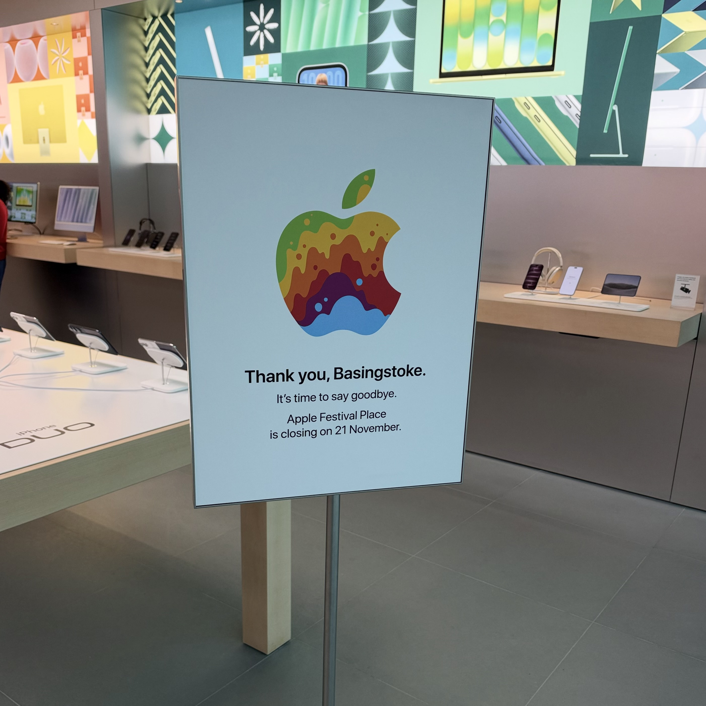

My local Apple Store in Basingstoke is closing next week.  On the one hand, it's not entirely unexpected. I've often noticed it's quite empty on weekdays (though weekends and the run-up to Christmas are always very busy). On the other hand, Apple aren't exactly struggling financially, and while I understand they're not a charity, I would have preferred to see them support a local community. There's something about having a local Apple Store that makes a company based in an increasingly insular Silicon Valley more approachable and relatable.   
The closure of the Basingstoke store is a real shame and perhaps reveals the true ruthlessness behind the friendly advertising and marketing speak that was always there.  Ordering something online is so much better when you know you can pop into town and return it if there's a problem. The staff there have helped me with numerous issues over the past decade. My nearest store will now be in Reading, a 40-minute drive away- a far cry from 15 minutes on my bike!  Wishing all the staff who work there the very best.
